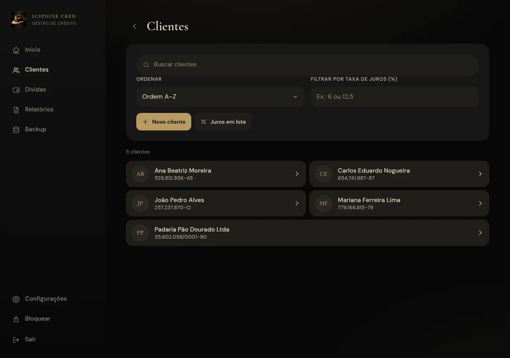
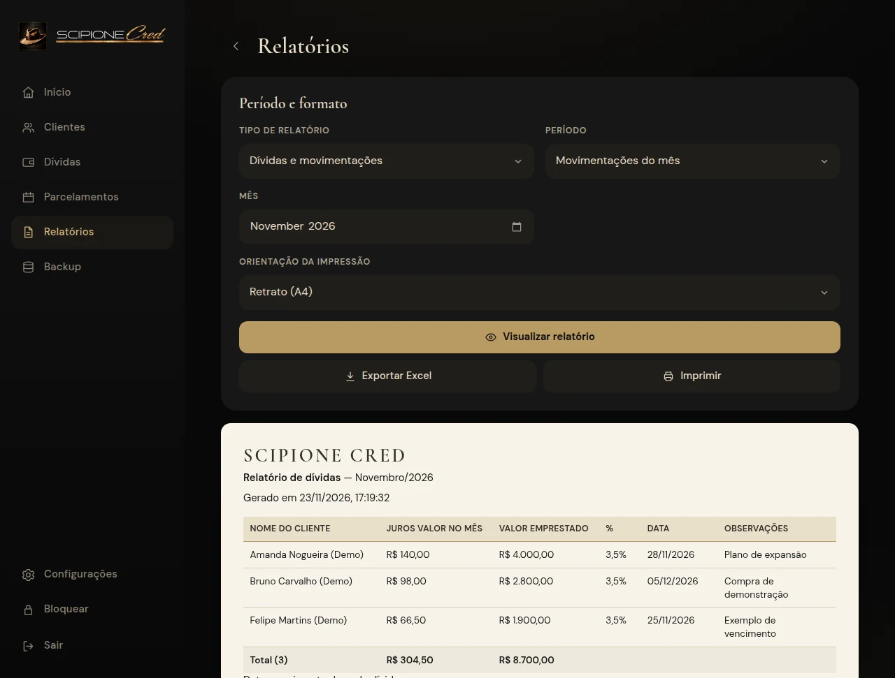
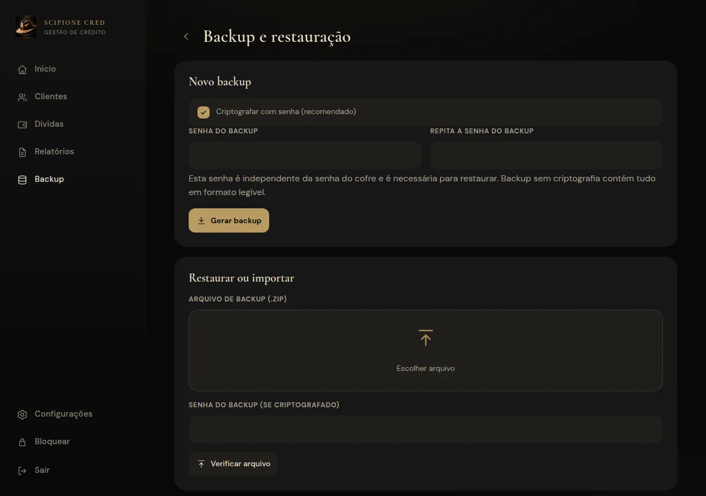
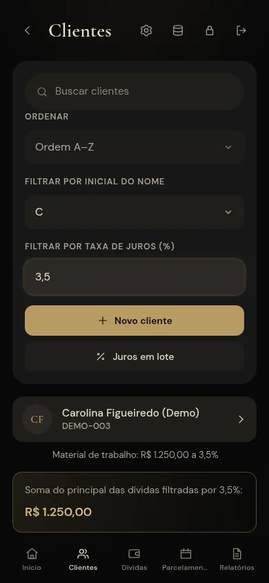
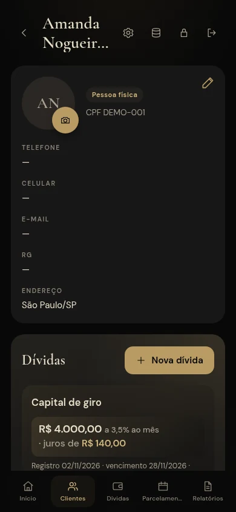

<p align="center">
  
</p>

<h1 align="center">SCIPIONE CRED</h1>

<p align="center">
  <strong>Gestão de clientes e dívidas, offline e criptografada.</strong><br>
  Um cofre local para organizar crédito, vencimentos, documentos e histórico. Os dados ficam no aparelho; apenas o CPF é enviado para validação online quando você usa esse recurso.
</p>

<p align="center">
  
  
  
  
</p>

---

## Visão geral

O **SCIPIONE CRED** é um aplicativo web progressivo (PWA) para gestão de clientes e dívidas. Roda inteiramente no navegador, guarda os registros no IndexedDB e protege o conteúdo com uma senha mestra.

Foi pensado para uso pessoal e profissional em cenários que exigem discrição: os dados permanecem no aparelho, o aplicativo funciona offline e cada instalação tem seu próprio cofre.

## Capturas

> Os nomes, documentos e valores exibidos nas capturas são dados fictícios de demonstração.

### Login

<p align="center">
  <br>
  <sub>Login com duas cenas do escritório que se alternam automaticamente.</sub>
</p>

<p align="center">
  <br>
  <sub>Versão mobile com a mesma identidade visual.</sub>
</p>

### Desktop

<p align="center">
  <br>
  <sub>Painel com saldo total, juros mensais, clientes, vencimentos e atividade recente.</sub>
</p>

<table align="center">
  <tr>
    <td width="50%"><br><sub>Clientes com busca, filtros e foto.</sub></td>
    <td width="50%"><br><sub>Dívidas, filtros e situação de vencimento.</sub></td>
  </tr>
  <tr>
    <td width="50%"><br><sub>Perfil com dados e dívidas.</sub></td>
    <td width="50%"><br><sub>Sistema, segurança, instalação e vencimentos.</sub></td>
  </tr>
  <tr>
    <td width="50%"><br><sub>Relatório mensal pronto para impressão.</sub></td>
    <td width="50%"><br><sub>Backup, restauração e verificação de integridade.</sub></td>
  </tr>
</table>

### Mobile

<table align="center">
  <tr>
    <td><br><sub>Painel</sub></td>
    <td><br><sub>Clientes</sub></td>
    <td><br><sub>Perfil</sub></td>
  </tr>
  <tr>
    <td><br><sub>Dívidas</sub></td>
    <td><br><sub>Configurações</sub></td>
    <td></td>
  </tr>
</table>

## Recursos

### Clientes

- Cadastro de pessoa física e jurídica, com validação e máscara de CPF/CNPJ.
- Formulário dividido em **Dados pessoais** e **Endereço**, com títulos discretos e espaçamento próprio. Pessoa física tem tipo, CPF, nome, data de nascimento e gênero no topo; para pessoa jurídica, o campo de nome vira **Razão social**. Quando online, o CPF é validado na APICPF e nome, nascimento e gênero são preenchidos se ainda estiverem vazios; o status mostra **Validado** ou **Inválido**. Sem internet, chave ausente ou limite atingido, nada é exibido e o preenchimento segue manual. Para CNPJ não há consulta.
- Dados de contato, endereço, foto e documentos anexos.
- Endereço com CEP, rua, número, complemento, bairro, cidade e UF; quando online, o CEP é consultado no ViaCEP e rua, bairro, cidade e UF são preenchidos automaticamente. Sem internet ou sem resposta da API, todos os campos continuam editáveis manualmente.
- Foto do cliente com recorte automático; iniciais são usadas quando não há imagem.
- Busca, ordenação e filtros por taxa de juros.
- Lista paginada com 20 clientes por página, preservando busca, filtros e ordenação.
- Perfil com dados, dívidas, documentos e histórico, nessa ordem.
- Histórico paginado com as 5 atividades mais recentes por página.
- Ajuste de juros em lote a partir da lista de clientes.

### Dívidas

- Valor principal, taxa mensal, data de registro, vencimento e observações.
- Cálculo de juros simples em centavos, com aritmética inteira (`BigInt`).
- Indicadores de dívidas vencidas e prestes a vencer.
- Lista paginada com 10 dívidas por página, preservando filtros e ordenação.
- Ajuste de taxa em lote com pré-visualização antes de aplicar.
- Janela de vencimento configurável na tela de Configurações.

### Painel e relatórios

- Saldo total de dívidas, juros mensais, clientes e vencimentos.
- Últimos clientes e atividades recentes.
- Relatório mensal ou diário para impressão em A4, em retrato ou paisagem.
- Coluna de vencimento em cada dívida do relatório.
- Exportação para Excel (`.xlsx`) sem dependência de biblioteca de planilhas.

### Segurança e backup

- Cofre protegido por senha, com PBKDF2-SHA256 (600.000 iterações) e AES-GCM de 256 bits.
- Chave de dados (DEK) separada e embrulhada pela chave derivada da senha.
- Sessão mantida ao recarregar a página e encerrada ao sair, bloquear ou após o tempo de inatividade.
- Bloqueio automático por inatividade e atraso após tentativas incorretas.
- Backup em ZIP, com criptografia opcional e verificação de integridade por SHA-256.
- Restauração com modos **mesclar** ou **substituir tudo**.
- Backup e restauração opcionais no Google Drive, com OAuth no navegador,
  escopo mínimo `drive.file` e verificação SHA-256 antes de restaurar.

### Configurações

- Tela centralizada para os cards **Sistema**, **Segurança**, **Instalação** e **Vencimentos**.
- No celular, acesso pelo ícone de engrenagem no canto superior direito, ao lado do bloqueio.
- No tablet e no desktop, acesso pelo item **Configurações** no rodapé do menu lateral.
- Inclui bloqueio automático, teste de gravação e leitura criptografada, instalação do PWA e definição da janela de vencimentos.

### Experiência

- PWA instalável no celular e no desktop.
- Funciona offline depois do primeiro carregamento.
- Layout responsivo para celular, tablet e desktop.
- Duas cenas de login que se alternam automaticamente com crossfade suave.
- Navegação por teclado, foco visível, alvos de toque e respeito a `prefers-reduced-motion`.
- Barras de rolagem ocultas, mantendo a rolagem por toque, roda e teclado.
- Áreas de upload pontilhadas, com ícone central e texto simples.
- Transições leves entre telas e indicadores de carregamento nas ações assíncronas.

### Identidade visual

- **Cores:** preto absoluto `#080808`, grafite `#171717`, dourado envelhecido `#B89A62`, marfim `#E8DFC9` e bronze escuro `#34302A`.
- **Tipografia:** Cormorant Garamond no logotipo, títulos e elementos institucionais; DM Sans em menus, tabelas, formulários e informações operacionais.
- **Fontes locais:** os arquivos ficam em `assets/fonts`, são carregados pelo próprio app e entram no cache offline do service worker.
- **Direção:** interface escura, dourado moderado, ícones minimalistas, sem divisórias decorativas e com animações discretas.

## Stack

| Camada | Tecnologia |
| --- | --- |
| Interface | HTML5, CSS3 e JavaScript (ES Modules) |
| Dados | IndexedDB |
| Criptografia | Web Crypto API — PBKDF2-SHA256 e AES-GCM 256 |
| PWA | Service Worker e Web App Manifest |
| Relatórios e backup | Geração própria de XLSX e ZIP com `fflate` |
| Testes | Node.js, sem dependências externas |
| Build | Nenhum — site estático |
| Deploy | Vercel ou GitHub Pages |

## Estrutura do projeto

```text
.
├── index.html
├── manifest.json
├── sw.js
├── vercel.json
├── package.json
├── .env.example
├── .github/
│   └── workflows/
│       └── ci.yml
├── api/
│   └── cpf.js
├── css/
│   ├── app.css
│   └── ui.css
├── scripts/
│   ├── check-static.mjs
│   └── run-tests.mjs
├── src/
│   ├── config/
│   ├── core/
│   ├── db/
│   ├── domain/
│   ├── export/
│   ├── files/
│   ├── security/
│   ├── services/
│   ├── ui/
│   │   ├── shell.js
│   │   ├── dashboard.js
│   │   ├── clients.js
│   │   ├── clientlist.js
│   │   ├── debts.js
│   │   ├── debtspage.js
│   │   ├── tools.js
│   │   ├── settings.js
│   │   ├── avatar.js
│   │   ├── kit.js
│   │   └── icons.js
│   ├── main.js
│   └── pwa.js
├── assets/
│   ├── fonts/
│   ├── icons/
│   └── img/
├── tests/
│   ├── *.test.mjs
│   ├── helpers/
│   └── unit/
├── vendor/
│   └── fflate.min.js
└── docs/
    └── screenshots/
```

## Como rodar

### Requisitos

- Navegador moderno com suporte a ES Modules, Web Crypto, IndexedDB e Service Worker.
- Python 3 ou qualquer servidor HTTP estático.
- Node.js apenas para executar os testes; a suíte foi verificada em `v22.23.4` (não há execução registrada em Node 18/20).

### Ambiente local

O projeto não tem etapa de build nem dependências de produção. Sirva a raiz por HTTP:

```sh
python3 -m http.server 8080
```

Abra `http://localhost:8080`.

> O service worker e o Web Crypto exigem um contexto seguro. Use `localhost` ou HTTPS; abrir o `index.html` diretamente como arquivo não é suficiente.

### Instalação como aplicativo

- **Chrome/Edge:** use o ícone de instalação na barra de endereço.
- **iPhone/iPad:** Safari › Compartilhar › Adicionar à Tela de Início.
- **Android:** menu do navegador › Instalar aplicativo.

## Deploy

### Vercel

1. Importe o repositório em [vercel.com/new](https://vercel.com/new).
2. Use o preset **Other**.
3. Deixe **Build Command** e **Install Command** vazios.
4. Em **Output Directory**, use `.` (a raiz do repositório).
5. Em **Environment Variables**, crie `APICPF_API_KEY` com a chave da APICPF para habilitar a validação de CPF.
6. Faça o deploy.

O `vercel.json` já configura:

- `sw.js` sem cache HTTP e com escopo na raiz, para o aplicativo instalado receber atualizações;
- `/` e `index.html` sem cache, para evitar uma interface antiga;
- `X-Content-Type-Options: nosniff`, `Referrer-Policy: no-referrer`, `X-Frame-Options: DENY`, `Cross-Origin-Opener-Policy: same-origin-allow-popups` e `Content-Security-Policy: frame-ancestors 'none'` em todas as rotas (`vercel.json:38-57`).

O `frame-ancestors` **só existe nesse cabeçalho**: a CSP que endurece o documento está na `<meta http-equiv>` de `index.html:3` (`default-src 'self'`, `object-src 'none'`, `base-uri 'none'`, `form-action 'none'`), e `<meta>` não aceita `frame-ancestors` — a especificação ignora essa diretiva fora de um header. Nos dois canais, portanto, o que cada um entrega é diferente.

A variável `APICPF_API_KEY` é opcional: sem ela o aplicativo funciona normalmente e a validação de CPF fica manual. Ela é usada somente pela função serverless `api/cpf.js` e nunca é enviada ao navegador. A Vercel entrega o site por HTTPS, contexto exigido pelo service worker e pelo Web Crypto.

#### Variáveis de ambiente

Todas são lidas **a cada requisição**, só no lado servidor (`api/cpf.js:15-17`); não existe configuração de ambiente em código de navegador. Os placeholders estão em `.env.example`, e o valor padrão de cada uma está na coluna ao lado.

| Variável | Default | O que controla |
| --- | --- | --- |
| `APICPF_API_KEY` | vazio → `503` (`api/cpf.js:108`,`:109`) | chave da APICPF; sem ela a validação de CPF fica manual |
| `SCIPIONE_ALLOWED_ORIGINS` | vazio = só o host da requisição (`api/cpf.js:17`) | origens extras aceitas na checagem de `Origin`/`Referer` (previews fixos, outro domínio) |
| `CPF_QUOTA_WINDOW_MS` | 60000 (`api/cpf.js:16`) | tamanho da janela fixa da cota, em ms |
| `CPF_QUOTA_PER_IP` | 30 (`api/cpf.js:16`) | requisições por IP dentro da janela |
| `CPF_QUOTA_PER_INSTANCE` | 300 (`api/cpf.js:16`) | requisições por instância dentro da janela; é o trava-custos quando o IP é rotacionado |

> **A cota é por instância aquecida, não distribuída** (`api/cpf.js:19-22`): cada região e cada instância contam o próprio teto, e um IP novo a cada requisição circorna o limite por IP — nesse cenário quem segura o abuso é o `CPF_QUOTA_PER_INSTANCE`, e o estouro devolve `429` com `Retry-After` (`api/cpf.js:100`). **O teto real de custo não mora no repositório**: é uma regra de rate limit da WAF da Vercel, criada no dashboard. Em `vercel.json` a configuração por código (`routes[].mitigate`) só aceita as ações `challenge` e `deny` — rate limit e `log`/`bypass`/`redirect` não são configuráveis assim, e o SDK `@vercel/firewall` é dependência externa, proibida pelo projeto.

Passos no dashboard — **ainda não executados; a regra precisa ser criada à mão**:

1. No dashboard da Vercel, abra o projeto e entre em **Firewall** na barra lateral › **Configure** › **+ New Rule**.
2. Em **If**, escolha **Request Path** › **Equals** › `/api/cpf`.
3. Em **Then**, escolha **Rate Limit** e o algoritmo **Fixed Window**.
4. Ajuste **Time Window** para `60s` e **Request Limit** para `60`. No plano Hobby há 1 regra por projeto, chaves IP e JA4 Digest e janela fixa entre 10 s e 10 min.
5. Salve primeiro com a ação **Log** (não bloqueia nada), observe o tráfego da regra na página do Firewall por ~10 minutos e só então troque a ação final para **Too Many Requests (429)**.
6. **Save Rule** › **Review Changes** › **Publish**.

### GitHub Pages

1. Abra **Settings › Pages** no repositório.
2. Em **Build and deployment**, escolha **Deploy from a branch**.
3. Selecione a branch `main` e a pasta `/ (root)`.
4. Salve e aguarde a publicação.

A URL fica no formato `https://js171555.github.io/scipione-cred-offline/`.

O arquivo `.nojekyll` mantém os arquivos servidos exatamente como estão. Todos os caminhos são relativos, então o service worker, o manifesto e os ícones funcionam também nesse subdiretório. A diferença é que o GitHub Pages não permite os cabeçalhos definidos no `vercel.json` — nem os de cache, nem os de segurança — nem executa a função serverless: a validação de CPF fica silenciosamente manual, e nesse canal `frame-ancestors`/`X-Frame-Options` não existem, restando apenas o que a `<meta>` de `index.html:3` entrega.

## Segurança e privacidade

- A senha do cofre não é armazenada. Ela deriva uma chave (KEK) via PBKDF2-SHA256 com 600.000 iterações (`src/security/crypto.js:4`,`:6`); essa chave protege a DEK, que cifra os registros com AES-GCM 256 (`crypto.js:9-11`). Isso descreve o mecanismo, não é uma garantia de segurança por si: o que a cifra protege é o **conteúdo** de `clients`, `debts`, `documents`, `history` e `blobs` em repouso no IndexedDB.
- Para permitir índices e ordenação, poucos metadados (`id`, `createdAt` e `clientId`) permanecem em claro; o conteúdo dos registros é cifrado (`src/services/records.js:1`,`:7`). Também ficam em claro, por design: os parâmetros do cofre em `meta/vault` (`salt`, `iv`, `wrapped`, `iter` — `crypto.js:11`, gravado em `src/security/auth.js:21`), o contador de tentativas em `meta/guard` (`auth.js:26`-`:32`) e as preferências `settings/idleMinutes` e `settings/dueWindow` (`auth.js:21`,`:33`; `src/services/settings.js:2`,`:3`). Um dump do banco revela, portanto, quantidade de clientes, UUIDs, datas e o grafo dívida↔cliente, mas não nomes, CPFs, valores nem anexos.
- Enquanto há sessão viva, a DEK é persistida como `CryptoKey` em `meta/session` para que a mesma aba reabra sem pedir senha de novo (`src/security/auth.js:55`), e esse registro é apagado no bloqueio e quando a sessão é inválida (`auth.js:43`,`:46`,`:67`). A chave é marcada como não extraível (`crypto.js:2`), o que impede ler os bytes da chave — não impede usá-la para decifrar a partir de código da mesma origem. O `localStorage` guarda só a configuração pública do cliente OAuth (`clientId`, `projectId`, origens), sem segredo (`src/services/google-drive.js:18`,`:45`; `src/config/google.js:4`-`:10`).
- O cofre não tem conta remota nem telemetria, e clientes, dívidas, documentos e histórico não são enviados a servidores. A exceção é o CPF digitado no cadastro: quando online e com a chave configurada, ele é enviado **apenas como 11 dígitos** (`src/services/apicpf.js:7`,`:8`) **no corpo de um POST** à nossa função serverless `/api/cpf` (`src/services/apicpf.js:28-33`) — o número não vai mais na URL, que é justamente a parte vista por log de intermediário, histórico do navegador e APM. A função repassa a consulta à APICPF (`api/cpf.js:114`) e **nessa perna a URL continua com `?cpf=`**: o contrato da provedora é GET com query string e não é nosso para mudar. Nome, nascimento e gênero voltam de terceiro, chegam normalizados (`src/services/apicpf.js:38-42`) e só preenchem campos vazios (`src/ui/clients.js:87`,`:88`). A chave fica apenas no servidor; veja `docs/apicpf.md`. O `GET /api/cpf?cpf=` legado segue aceito, para aparelhos com bundle pré-cacheado, e está documentado como deprecado (`api/cpf.js:71-72`). O CEP digitado segue o mesmo desenho: vai só o CEP ao ViaCEP e voltam rua, bairro, cidade e UF (`src/services/viacep.js:3`,`:17`; `src/ui/clients.js:106`). Se você ativar o backup no Google Drive, o ZIP gerado sobe para a sua conta Google (`src/services/google-drive.js:194`) — cifrado apenas se a criptografia com senha foi marcada.
- O `/api/cpf` **não exige credencial**: o que ele aplica hoje são o transporte no corpo, a checagem de `Origin`/`Referer` (`api/cpf.js:48`, resposta `403` em `:98`) e a cota por IP e por instância (`api/cpf.js:58`, resposta `429` com header `Retry-After` em `:100`). `Origin` é controlado pelo cliente, então isso inibe uso embarcado em outro site — **não é autenticação**, e um ataque deliberado com header ausente ou spoofado continua dependendo da regra de rate limit da WAF, criada no dashboard da Vercel (ver Deploy › Vercel).
- **Não há recuperação de senha.** Se a senha do cofre for esquecida, os dados não poderão ser abertos. Use uma senha forte e mantenha backups.
- A criptografia protege os dados em repouso. Ela não protege contra aparelho comprometido, malware ou acesso ao app desbloqueado.
- O atraso após tentativas incorretas é local e contornável; a defesa principal é o custo do PBKDF2 e uma senha forte.

## Backup e restauração

- O backup é um ZIP com `manifest.json`, dados e documentos. A criptografia é opcional, mas recomendada.
- A senha do backup é independente da senha do cofre e é obrigatória para restaurar um backup criptografado.
- A restauração valida a estrutura, os hashes SHA-256 e os relacionamentos antes de alterar o banco.
- No modo **mesclar**, clientes com o mesmo CPF/CNPJ não são duplicados e dívidas com o mesmo `id` são ignoradas.
- No modo **substituir tudo**, o estado atual é apagado e trocado pelo backup em uma única transação.
- O Google Drive é um segundo destino, não substitui o backup local. A conta é
  autorizada no navegador e o token fica apenas na memória da aba.

> O Google Drive já usa um cliente OAuth **Aplicativo da Web** configurado para
> `https://scipione-cred-offline.vercel.app`. Para testar em localhost ou em outro
> domínio, autorize a origem no Google Cloud ou importe o JSON do cliente Web. O
> passo a passo e os erros comuns estão em [docs/google-drive.md](docs/google-drive.md).

> Cada origem tem um cofre próprio. `localhost`, o domínio da Vercel e o endereço do GitHub Pages são cofres separados. Para migrar dados entre ambientes, gere um backup e restaure no novo endereço.

> No iOS, o Safari pode remover dados de sites não instalados após um período sem uso. Instale o app na Tela de Início e mantenha backups regulares.

## Testes

Os testes usam apenas Node.js, sem dependências externas. Comando canônico:

```sh
node --test "tests/**/*.test.mjs"
```

Estado medido da suíte com esse comando, nesta branch e em Node `v22.23.4`: **497 casos, 55 suítes, 0 falhas, 0 cancelados, ~10,7 s** — 28 arquivos, 4.509 linhas, 1.180 chamadas de `assert`. O conjunto fica verde nos dois fusos da CI (`TZ=America/Sao_Paulo` e `TZ=UTC`). Antes desta correção eram 461 casos; os 36 novos estão em `tests/apicpf.test.mjs` (20 → 40), `tests/unit/apicpf-client.test.mjs` (11 → 15), `tests/svc/debts.test.mjs` (17 → 23) e `tests/contracts/docs-refs.test.mjs` (6, arquivo novo).

Duas variantes são proibidas, e as duas foram medidas em Node `v22.23.4`:

- `node --test tests` (o diretório, sem glob) **falha** — `Cannot find module '…/tests'`, exit 1.
- o laço `for t in …; do node tests/$t.test.mjs; done` **engole a falha**: em bash o código de saída de um laço é o do último comando, então um arquivo quebrado no início passa se o último terminar verde.

Em lugar do comando cru, `node scripts/run-tests.mjs` roda o mesmo conjunto com gate (conta os arquivos descobertos, lê o exit code sem pipe e relê o TAP exigindo `# fail 0`), e `node scripts/check-static.mjs` roda as checagens estáticas (sintaxe com `node --check`, arquivos essenciais, `sw.js`, JSON, premissa de zero dependências e segredos commitados).

O `push` e os pull requests passam por `.github/workflows/ci.yml`, com três jobs: `estatico`, `testes` (matriz de fuso `America/Sao_Paulo` e `UTC`, bloqueante, com artefatos TAP/JUnit/cobertura) e `smoke-navegador` — este último `continue-on-error: true`, disparado apenas por `workflow_dispatch`, que hoje **não executa nenhum teste de navegador**: serve para detectar o browser do runner e registrar o roteiro do que ainda falta virar teste. O workflow não faz deploy e não instala dependências.

A suíte cobre aritmética monetária, validadores de CPF/CNPJ, máscara e composição de endereço, situação de vencimento e busca, criptografia do cofre, formato de backup/restauração e a função serverless da APICPF. **Não existe smoke test de ponta a ponta da interface**: cobertura de UI em navegador real é avaliação futura, não entrega atual. Tudo roda em Node puro, com harness próprios em `tests/helpers/` (IndexedDB e DOM falsos, mock de `fetch`); nenhum arquivo em `tests/` abre um navegador.

O teste de navegador que exercita a **função serverless real** é **manual e está fora da CI**: um shim `node:http` serve `api/cpf.js` com o upstream da APICPF stubado em memória, e nada disso é arquivo versionado nem executado por `node --test`. Nesta rodada ele passou em 23/23 verificações (POST com corpo e nenhuma query na URL da função, preenchimento de nome/nascimento/gênero, `403` em origem estrangeira, `415` em content-type errado e, no caminho da dívida de cliente excluído, mensagem legível com o store `debts` inalterado).

## Compatibilidade

- Chrome, Edge, Safari e Firefox em versões atuais.
- Requer ES Modules, IndexedDB, Web Crypto e Service Worker.
- Funciona em celular, tablet e desktop, com layout adaptativo.
- A instalação como PWA depende de HTTPS ou `localhost`.

## Documentação

A documentação técnica detalhada está em `docs/`, um arquivo por responsabilidade:

| Documento | O que responde |
| --- | --- |
| [docs/README.md](docs/README.md) | índice do que existe em `docs/` e resumo técnico por área |
| [docs/ARCHITECTURE.md](docs/ARCHITECTURE.md) | camadas, módulos, dependências e invariantes de arquitetura |
| [docs/PROJECT_MAP.md](docs/PROJECT_MAP.md) | "onde eu modifico esta funcionalidade?" — mapa por funcionalidade com `arquivo:linha` |
| [docs/DATABASE.md](docs/DATABASE.md) | stores do IndexedDB, formato do registro cifrado, índices, migrações, cofre/sessão e backup |
| [docs/SECURITY.md](docs/SECURITY.md) | cofre, sessão, superfície de ataque, cabeçalhos/CSP, serverless e saída de dados |
| [docs/API.md](docs/API.md) | catálogo das interfaces exportadas por módulo (`arquivo:linha` de cada definição) |
| [docs/TESTING.md](docs/TESTING.md) | como a suíte roda, o que cada camada cobre (com cobertura medida) e o que só teste de navegador prova |
| [docs/ROADMAP.md](docs/ROADMAP.md) | pendências priorizadas a partir das auditorias |
| [docs/apicpf.md](docs/apicpf.md) | como funciona a validação de CPF e onde a chave mora |
| [docs/google-drive.md](docs/google-drive.md) | OAuth do Drive, escopo `drive.file`, configuração por origem e erros comuns |
| [docs/auditoria-ui-ux-codigo.md](docs/auditoria-ui-ux-codigo.md) | auditoria anterior de UI/UX e código, com o que foi aceito como risco |
| [docs/CHANGELOG.md](docs/CHANGELOG.md) | histórico de versões e o que mudou em cada uma |
| [AGENTS.md](AGENTS.md) | convenções de contribuição para quem edita o repositório (arquivo na raiz) |

Todo documento acima carrega `arquivo:linha` conferido contra o código; a suíte está em `tests/` e o estado real de cobertura, nos 15 comportamentos auditados, está descrito em [`docs/TESTING.md`](docs/TESTING.md).

## Licença

Este é um projeto pessoal. Não há licença de código aberto definida neste repositório; para reutilização ou distribuição, entre em contato com o autor.

## Autor

Desenvolvido por [JS171555](https://github.com/JS171555).

---

<p align="center"><sub>SCIPIONE CRED — seus dados ficam com você.</sub></p>
