<div align="center">

[](https://scipione-cred-offline.vercel.app/)

# SCIPIONE CRED

**Gestão offline e criptografada de clientes e dívidas.**

Um cofre que roda inteiro no navegador: os dados ficam no seu aparelho, cifrados com a sua senha, e não são enviados a nenhum servidor.

[](https://scipione-cred-offline.vercel.app/)
[](https://js171555.github.io/scipione-cred-offline/)
[](#instalar-como-pwa)
[](#integrações-opcionais)
[](#modelo-de-segurança)

[](#estrutura-do-repositório)
[](#estrutura-do-repositório)
[](#estrutura-do-repositório)
[](#ambiente-local)
[](#testes)
[](#dados-e-armazenamento)

</div>

---

## Sumário

- [O que torna este projeto diferente](#o-que-torna-este-projeto-diferente)
- [Para quem é e para quem não é](#para-quem-é-e-para-quem-não-é)
- [Demonstração](#demonstração)
- [Telas](#telas)
- [Funcionalidades](#funcionalidades)
- [Arquitetura](#arquitetura)
- [Modelo de segurança](#modelo-de-segurança)
- [Dados e armazenamento](#dados-e-armazenamento)
- [Cálculo de juros](#cálculo-de-juros)
- [Configurações do aplicativo](#configurações-do-aplicativo)
- [Instalação e execução](#instalação-e-execução)
- [Instalar como PWA](#instalar-como-pwa)
- [Integrações opcionais](#integrações-opcionais)
- [Testes](#testes)
- [Compatibilidade de navegadores](#compatibilidade-de-navegadores)
- [Estrutura do repositório](#estrutura-do-repositório)
- [Publicação](#publicação)
- [Solução de problemas](#solução-de-problemas)
- [Limites conhecidos](#limites-conhecidos)
- [Contribuindo](#contribuindo)
- [Documentação](#documentação)
- [Licenças e terceiros](#licenças-e-terceiros)
- [Autor](#autor)

---

## O que torna este projeto diferente

| Princípio | Como está implementado |
| --- | --- |
| **Local-first** | IndexedDB é a única base de dados. Não há servidor de contas, sincronização ou analytics do aplicativo. |
| **Criptografia real** | Web Crypto API: PBKDF2-SHA256 com 600.000 iterações deriva a chave que embrulha a chave dos dados, e cada registro é cifrado em AES-GCM 256. |
| **Sem etapa de build** | ES Modules servidos como estão. Sem bundler, sem transpiler, sem `node_modules` para usar o app. |
| **Pegada de rede mínima** | CSP no `index.html`: `script-src 'self'` mais o Google Identity Services, sem `unsafe-eval`, e `connect-src` restrito a `'self'`, Google e ViaCEP. |
| **Funciona sem internet** | Service Worker com *cache-first* para todos os arquivos da aplicação: após o primeiro carregamento, o app abre offline. |
| **Honesto sobre riscos** | A documentação declara o que a criptografia **não** protege, e o app avisa antes de qualquer cadastro que a senha não tem recuperação. |

---

## Para quem é e para quem não é

**Serve bem** a quem empresta dinheiro, trabalha com crédito informal ou gerencia cobranças e quer controle total dos dados: cadastro de clientes, dívidas com juros mensais, vencimentos, parcelamentos, baixa de parcelas, documentos anexos, relatórios A4 e backups verificáveis.

**Não serve** a quem precisa de contabilidade, emissão de contrato, cobrança automática ou multiusuário. Também não sincroniza aparelhos por conta própria; a baixa financeira ocorre pelas parcelas de um plano, não por um fluxo independente de quitação.

---

## Demonstração

| Ambiente | URL | Observações |
| --- | --- | --- |
| Produção (Vercel) | https://scipione-cred-offline.vercel.app/ | Recomendada. Validação online de CPF disponível quando `APICPF_API_KEY` está configurada. |
| Espelho (GitHub Pages) | https://js171555.github.io/scipione-cred-offline/ | Site puramente estático: a rota `/api/cpf` não existe, então a validação de CPF fica manual. |

> **Cada origem tem o próprio cofre.** `localhost`, Vercel e GitHub Pages usam três bases IndexedDB independentes, cada uma com sua senha. Trocar de endereço não migra nada: para levar os dados de um ao outro, use Backup e Restauração.

---

## Telas

As capturas abaixo foram feitas na versão atual, em um cofre local isolado e com dados fictícios de demonstração; não há dados de clientes reais.

<table>
  <tr>
    <td align="center" width="33%"><br><sub><b>Acesso</b><br>Criação do cofre local, sem recuperação de senha.</sub></td>
    <td align="center" width="33%"><br><sub><b>Painel</b><br>Saldo, juros, vencimentos, clientes e atividades recentes.</sub></td>
    <td align="center" width="33%"><br><sub><b>Clientes</b><br>Busca, inicial alfabética e filtro de taxa com soma do principal.</sub></td>
  </tr>
  <tr>
    <td align="center" width="33%">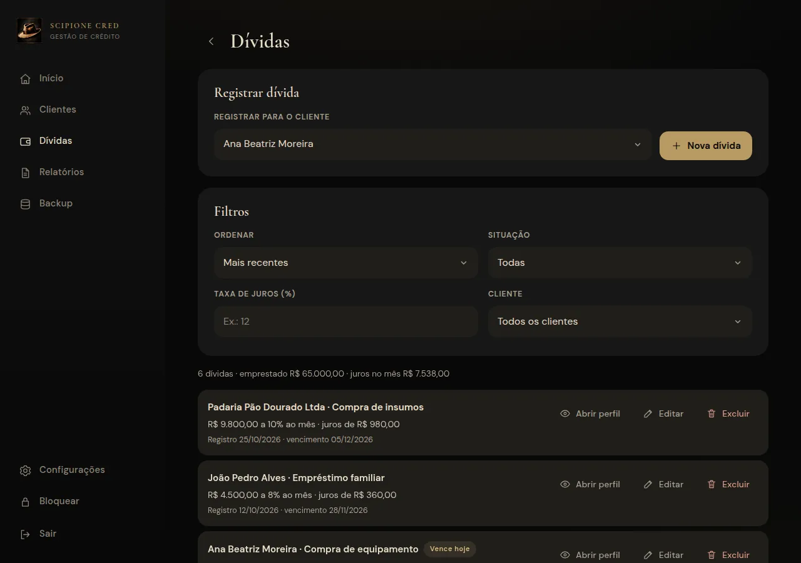<br><sub><b>Dívidas</b><br>Filtros de taxa e situação, com resumo recalculado.</sub></td>
    <td align="center" width="33%">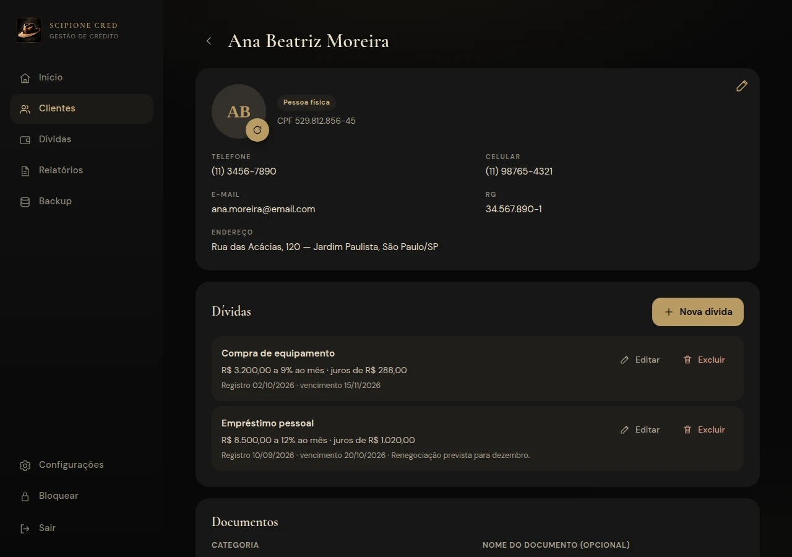<br><sub><b>Perfil</b><br>Cadastro, saldo, dívidas e histórico de atividades.</sub></td>
    <td align="center" width="33%"><br><sub><b>Relatório de dívidas</b><br>Pré-visualização A4, impressão e exportação Excel.</sub></td>
  </tr>
  <tr>
    <td align="center" width="33%">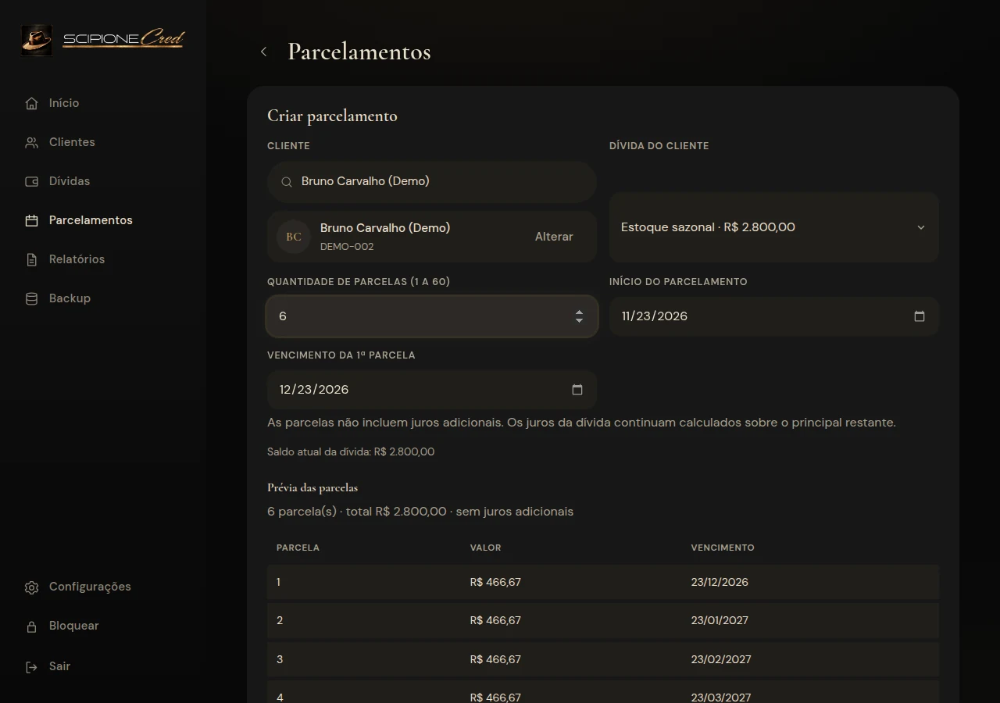<br><sub><b>Parcelamentos</b><br>Prévia do valor e vencimento de cada parcela.</sub></td>
    <td align="center" width="33%">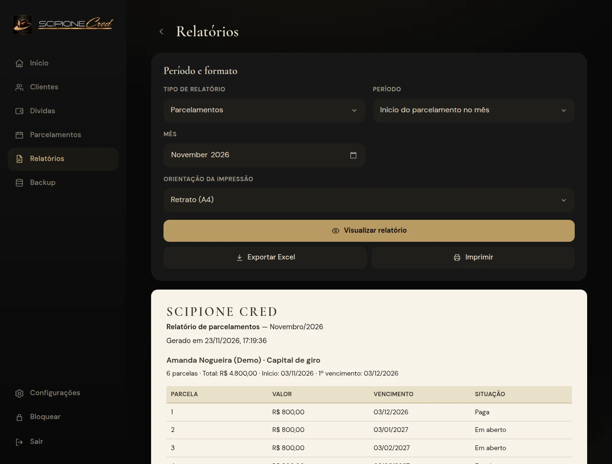<br><sub><b>Relatório de parcelas</b><br>Planos por período, valores, vencimentos e situação.</sub></td>
    <td align="center" width="33%"><br><sub><b>Backup</b><br>Backup criptografado e restauração local ou pelo Drive.</sub></td>
  </tr>
  <tr>
    <td align="center" width="33%">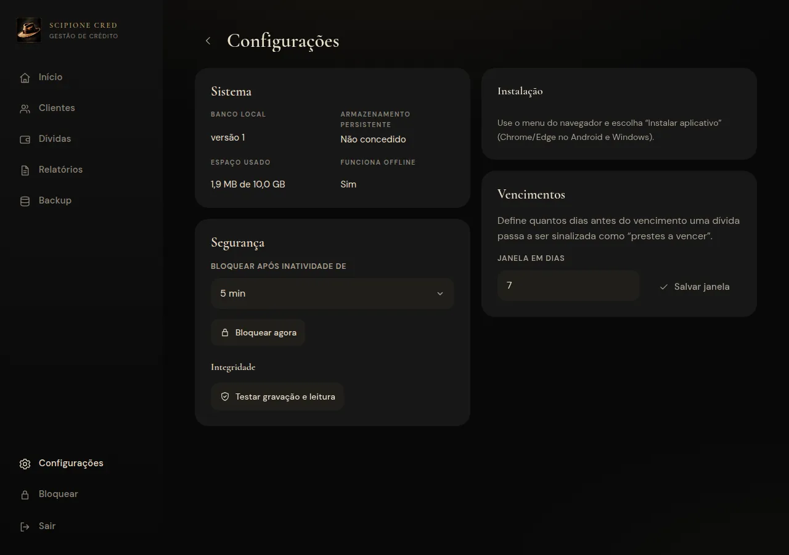<br><sub><b>Configurações</b><br>Segurança, integridade, instalação e vencimentos.</sub></td>
    <td colspan="2"></td>
  </tr>
</table>

<table>
  <tr>
    <td align="center" width="33%"><br><sub>Acesso</sub></td>
    <td align="center" width="33%">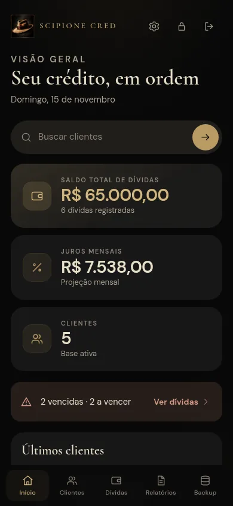<br><sub>Painel</sub></td>
    <td align="center" width="33%"><br><sub>Clientes e filtros</sub></td>
  </tr>
  <tr>
    <td align="center" width="33%">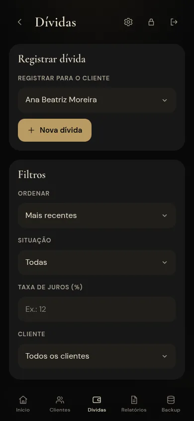<br><sub>Dívidas</sub></td>
    <td align="center" width="33%"><br><sub>Perfil</sub></td>
    <td align="center" width="33%">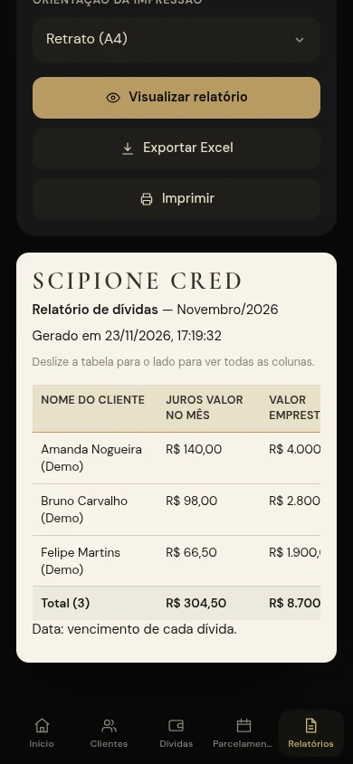<br><sub>Relatório de dívidas</sub></td>
  </tr>
  <tr>
    <td align="center" width="33%">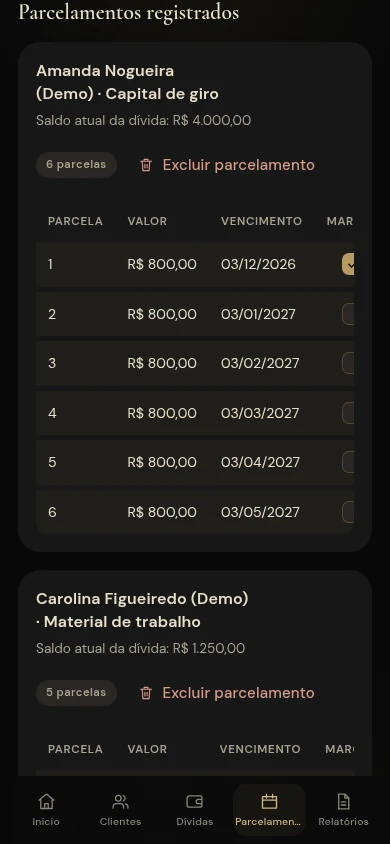<br><sub>Parcelamentos</sub></td>
    <td align="center" width="33%">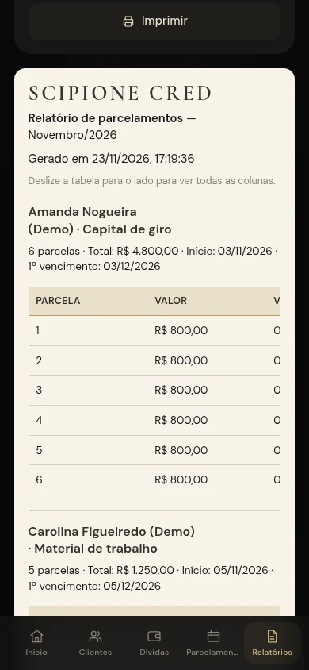<br><sub>Relatório de parcelas</sub></td>
    <td align="center" width="33%">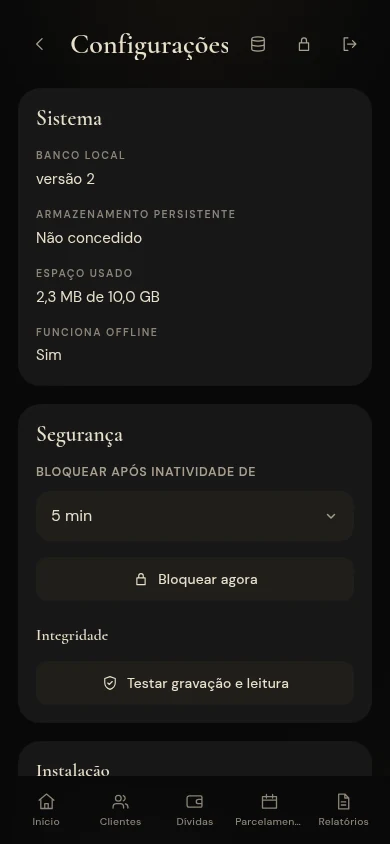<br><sub>Configurações</sub></td>
  </tr>
</table>

A navegação muda com a largura: barra inferior até 767 px, *rail* de 96 px entre 768 e 1.099 px, menu lateral a partir de 1.100 px.

---

## Funcionalidades

### Clientes

- Pessoa física ou jurídica, com máscara e validação de dígito verificador de CPF/CNPJ.
- Dados pessoais, contatos, endereço completo (CEP, rua, número, complemento, bairro, cidade, UF), foto e documentos anexos.
- Busca por nome, e-mail ou RG ignorando acentos e caixa, e por dígitos em CPF, CNPJ, RG, telefone ou celular quando o texto é numérico.
- Ordenação A–Z/Z–A ou por data; filtro alfabético por uma inicial individual, combinável com a busca.
- Filtro pela taxa mensal selecionada: exibe clientes com dívidas naquela taxa, detalha os valores correspondentes e soma o principal filtrado.
- Lista paginada com 20 clientes por página.
- Ajuste de taxa de juros em lote com pré-visualização antes de gravar.
- Perfil do cliente reunindo dados, dívidas, documentos e histórico paginado (5 eventos por página).
- Consulta de CEP pelo ViaCEP quando há conexão; offline os campos continuam editáveis.

### Dívidas e juros

- Descrição, valor emprestado, taxa mensal, data de registro, vencimento e observações.
- Juros sempre derivados do par *valor × taxa*: não existe campo de juros avulso, então nada diverge do cadastro.
- Situação por dívida: **vencida**, **prestes a vencer** (dentro da janela configurável) ou **em dia**.
- Filtros por taxa mensal, cliente e situação; ordenação por data mais recente ou mais antiga.
- Lista paginada com 10 dívidas por página; quantidade, principal emprestado e juros mensais refletem os filtros ativos.
- Ajuste em lote aplicado em uma única transação, recusado se os dados mudaram desde a busca.
- Validações do domínio: valor maior que zero e até `R$ 100.000.000.000,00`, taxa entre 0,01% e 1000%, vencimento não anterior ao registro.

### Parcelamentos

- Gere de 1 a 60 parcelas para uma dívida com saldo positivo, informando a data de início e o primeiro vencimento. Uma dívida pode ter apenas um parcelamento ativo.
- A prévia distribui o principal em centavos e mantém a soma exatamente igual ao saldo; vencimentos seguintes avançam mês a mês, sem acrescentar juros às parcelas.
- Marcar uma parcela como paga desconta seu valor do principal; desfazer a baixa devolve exatamente o mesmo valor. A projeção de juros continua usando o principal restante.
- O plano reúne parcelas, vencimentos e situação (paga ou em aberto). Excluir o plano mantém o saldo atual da dívida; valores já baixados não são revertidos.

### Painel, relatórios e Excel

- Métricas em tempo real: saldo total, projeção de juros mensais, clientes ativos e contagem de vencidas e a vencer.
- Últimos clientes cadastrados e atividades recentes, ambos lidos do banco cifrado.
- Relatório de dívidas mensal ou diário: dívidas registradas no período e movimentações do histórico, em A4 retrato/paisagem, com pré-visualização e impressão pelo navegador.
- Relatório de parcelamentos mensal ou diário, filtrado pela data de início do plano, com parcelas, valores, vencimentos e situação.
- Exportação `.xlsx` de dívidas com as abas **Dívidas** e **Movimentações**; para parcelamentos, abas **Parcelamentos** e **Parcelas**, incluindo situação de pagamento. Os arquivos são gerados por um escritor próprio de XML + ZIP, sem biblioteca de planilha.

### Backup e restauração

- Backup em ZIP com contagens, versão do formato, versão do banco e SHA-256 de cada arquivo.
- Planos de parcelamento, parcelas e baixas acompanham o backup e a restauração; vínculos e consistência dos saldos são verificados antes da gravação.
- Criptografia opcional do arquivo com senha própria, independente da senha do cofre (PBKDF2, 600.000 iterações).
- Restauração em dois modos: **mesclar** (cliente com o mesmo CPF/CNPJ não é duplicado; dívida com `id` já existente é ignorada) ou **substituir tudo**.
- Verificação de estrutura, hashes e relacionamentos antes de tocar no banco; se um arquivo não confere, nada é alterado.
- Google Drive opcional: envio, listagem e restauração usando escopo `drive.file` e OAuth no navegador.

### Interface e acessibilidade

- PWA instalável com ícones dedicados (192, 512, *maskable* e *apple-touch*) e modo *standalone*.
- Navegação por teclado com *link* "Ir para o conteúdo", foco visível, `aria-current` e alvos de toque de pelo menos 44 px.
- Respeito a `prefers-reduced-motion` e mensagens com `role="alert"` / `role="status"`.
- Identidade visual escura e dourada, com Cormorant Garamond e DM Sans servidas localmente e em cache offline.
- A logo `assets/img/scipione-cred-logo.png` identifica o app no canto superior esquerdo: na barra lateral em telas largas e no cabeçalho de Início em telas menores. O chapéu permanece como ícone do sistema.
- Na tela de acesso, o ícone do chapéu fica centralizado acima da logo; `office.webp` e `office-desk.webp` alternam como cenário, com movimento reduzido respeitado.
- Interface 100% em português brasileiro, inclusive datas, moeda e nomes de arquivos gerados.

---

## Arquitetura

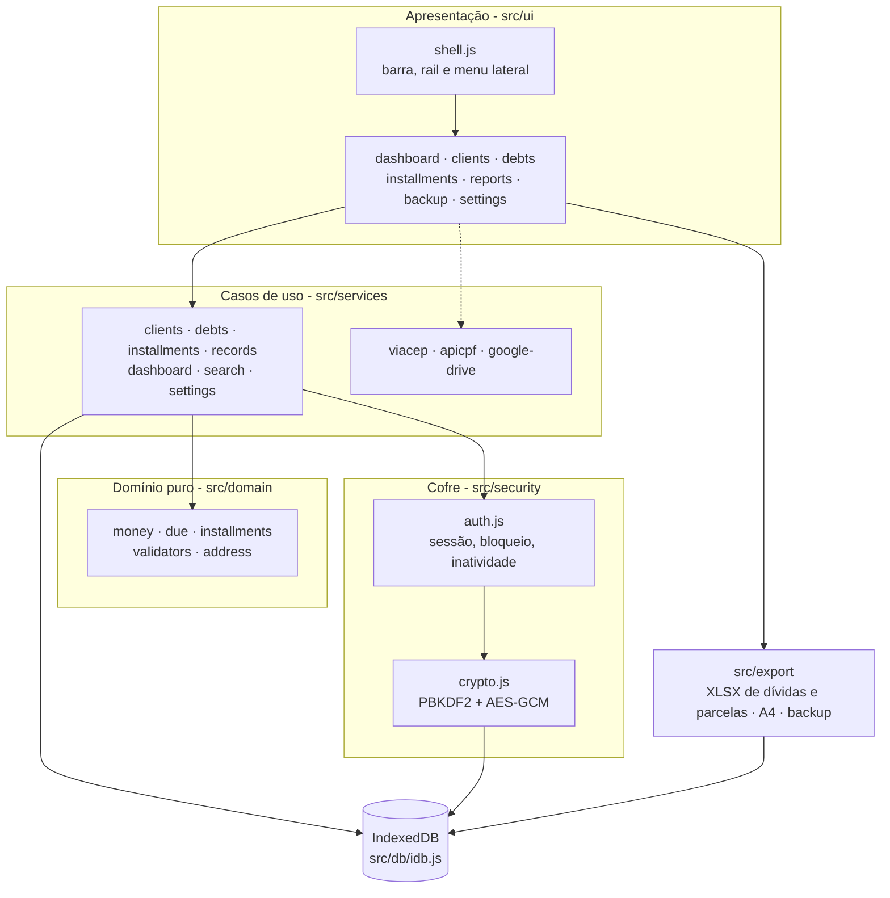

| Camada | Onde | Responsabilidade |
| --- | --- | --- |
| Entrada | `index.html`, `src/main.js` | Shell, troca de telas, tradução de erros do cofre. |
| Apresentação | `src/ui` | Telas, ícones SVG próprios e paginação, sem regra de negócio. |
| Casos de uso | `src/services` | Leitura/gravação, métricas do painel, busca e integrações. |
| Domínio | `src/domain` | Dinheiro em centavos, vencimentos, validadores e endereço. |
| Cofre | `src/security` | Derivação de chave, cifragem, sessão, bloqueio e atraso. |
| Persistência | `src/db` | IndexedDB versionado, com gravação confirmada em `oncomplete`. |
| Exportação | `src/export` | Escritor de XLSX, relatório A4 e formato de backup com SHA-256. |
| PWA | `src/pwa.js`, `sw.js`, `manifest.json` | Instalação, cache offline, armazenamento persistente e atualização. |

A aplicação usa módulos ES nativos, sem etapa de build. A única biblioteca de terceiros carregada em execução é `fflate`, servida localmente de `vendor/` para gerar arquivos ZIP.

---

## Modelo de segurança

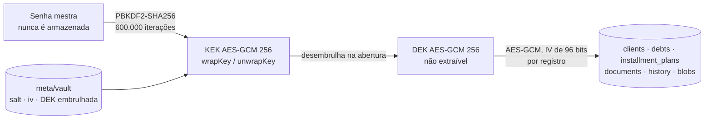

- **Envelope de chave.** A senha deriva uma KEK; a KEK apenas embrulha a DEK gerada aleatoriamente. Trocar a senha não exige recifrar o banco, e não existe *hash* de senha comparado: a senha correta é a que abre a DEK pela tag de autenticação do GCM.
- **Cifragem por registro.** Cada objeto é cifrado com `AES-GCM` e IV aleatório de 96 bits; fotos e documentos seguem o mesmo caminho em `blobs`.
- **Chave em execução.** Após o `unwrapKey`, a DEK é uma chave não extraível: o JavaScript do app não consegue exportá-la.
- **Sessão e bloqueio.** A sessão só reabre na mesma aba e dentro do prazo de inatividade (padrão 5 minutos). Bloquear ou sair descarta a chave e apaga a sessão salva.
- **Atraso progressivo.** Depois de 5 senhas incorretas, cada tentativa adiciona atraso exponencial de 5 s até 300 s.
- **Backup autoverificável.** ZIP com `manifest.json` (contagens, versão, SHA-256 por arquivo) ou, se criptografado, `manifest.json` com salt e iterações mais `payload.enc` com o ZIP interno cifrado.
- **Cabeçalhos e CSP.** A `<meta>` do `index.html` traz CSP sem `unsafe-eval`, com `object-src 'none'`, `base-uri 'none'`, `form-action 'none'` e `connect-src` nominal; o `vercel.json` reforça `frame-ancestors 'none'`, HSTS e `Permissions-Policy` no deploy.

### O que a criptografia protege e o que não protege

| Cenário | Coberto? | Motivo |
| --- | --- | --- |
| Cópia ou leitura do banco em disco | **Sim** | Os registros estão cifrados; sem a DEK não há texto legível. |
| Aparelho perdido com o cofre bloqueado | **Sim** | A DEK só existe depois de abrir o cofre. |
| Vazamento da cópia de segurança | **Sim**, se criptografada | A senha do backup é independente e obrigatória para restaurar. |
| Aparelho desbloqueado com o cofre aberto | **Não** | Dados abertos ficam em memória; malware ou XSS nesse estado consegue lê-los. |
| Senha do cofre esquecida | **Não** | Não há recuperação, redefinição por e-mail ou chave mestra oculta. |
| Metadados de índice (`id`, `createdAt`, `clientId`, `debtId` em planos) | **Não** | Ficam em claro por decisão de projeto para permitir índices, ordenação e unicidade do vínculo plano–dívida. |
| Força bruta remota contra a senha | **Parcial** | PBKDF2 e atraso local encarecem o ataque, mas não há limitador do lado do servidor. |

---

## Dados e armazenamento

| *Object store* | Chave | O que guarda | Visível em claro |
| --- | --- | --- | --- |
| `meta` | `key` | Envelope do cofre, contador de tentativas, sessão | Sim (só material público do envelope) |
| `settings` | `key` | Inatividade, janela de vencimentos e preferências | Sim |
| `clients` | `id` | Cadastro completo do cliente | `id`, `createdAt` |
| `debts` | `id` | Valor, taxa, registro, vencimento, observações | `id`, `createdAt`, `clientId` |
| `installment_plans` | `id` | Plano, parcelas, valores, vencimentos e situação de pagamento | `id`, `createdAt`, `clientId`, `debtId` |
| `documents` | `id` | Nome, categoria, tipo, tamanho e hash do arquivo | `id`, `createdAt`, `clientId` |
| `history` | `id` | Eventos de cadastro, alteração, exclusão e documentos | `id`, `createdAt`, `clientId` |
| `blobs` | `id` | Fotos e documentos anexos | `id` (bytes cifrados) |

- **Dinheiro em centavos inteiros.** `R$ 5.000,00` é `500000`; não há ponto flutuante no caminho do dinheiro.
- **Taxa em centésimos de ponto percentual.** `15%` ao mês é `1500`; o teto do domínio é 1000% (`100000`).
- **Fotos e documentos.** Limite de 15 MB por arquivo. A foto de perfil aceita imagens; os anexos aceitam imagens, PDF, `.doc` e `.docx`. JPG/PNG/WebP/BMP são reduzidos a no máximo 1600 px no maior lado e convertidos para WebP (qualidade 0,8) quando isso diminui o tamanho; PDFs e demais formatos são guardados como chegaram. O SHA-256 do original é registrado no documento.
- **Transações confirmadas.** Toda gravação só resolve em `transaction.oncomplete`, com `durability: 'strict'`, e operações relacionadas vão em lote único ("tudo ou nada").
- **Histórico automático.** Cadastro, alteração de campo, mudança de taxa, exclusão e documentos geram eventos com data e detalhe legível no perfil do cliente.

## Cálculo de juros

Juros simples mensais, em aritmética inteira (`BigInt`), com arredondamento ao centavo (meio para cima):

```js
// src/domain/money.js — principal em centavos, taxa em centésimos de ponto percentual
export const interest = (p, b) => Number((BigInt(p) * BigInt(b) + 5000n) / 10000n);
```

| Principal | Taxa mensal | Juros do mês |
| --- | --- | --- |
| R$ 5.000,00 | 15% | R$ 750,00 |
| R$ 3,33 | 10% | R$ 0,33 |
| R$ 3,35 | 10% | R$ 0,34 |
| R$ 100.000.000.000,00 | 1000% | R$ 1.000.000.000.000,00 |

O painel soma os juros de todas as dívidas cadastradas como **projeção mensal**. A baixa de uma parcela reduz o principal pelo valor exato dela e a projeção é recalculada sobre o saldo restante; não há pagamento parcial livre fora de um plano de parcelamento.

---

## Configurações do aplicativo

| Grupo | Opções | Padrão | Observações |
| --- | --- | --- | --- |
| Sistema | Versão do banco, armazenamento persistente, espaço usado, status offline | — | Somente leitura; o app solicita `navigator.storage.persist()` ao abrir. |
| Segurança | Bloquear após inatividade; bloquear agora; testar gravação e leitura | 5 min | Opções de 1, 5, 15 e 30 minutos. O teste escreve e lê uma sonda cifrada. |
| Instalação | Botão instalar ou instrução por plataforma | — | Usa `beforeinstallprompt` quando o navegador oferece. |
| Vencimentos | Janela em dias para "prestes a vencer" | 7 dias | Intervalo de 1 a 365 dias. |

---

## Instalação e execução

### Requisitos

- Navegador moderno com **ES Modules**, **Web Crypto API**, **IndexedDB** e **Service Worker**.
- **Python 3** (ou qualquer servidor de arquivos estáticos) para rodar localmente.
- **Node.js 18+** apenas para executar a suíte de testes.

> **Contexto seguro obrigatório.** Service Workers e `crypto.subtle` funcionam só em `localhost` ou HTTPS. Abrir o `index.html` pelo sistema de arquivos (`file://`) não funciona.

### Ambiente local

```bash
git clone https://github.com/JS171555/scipione-cred-offline.git
cd scipione-cred-offline
python3 -m http.server 8080
```

Abra <http://localhost:8080> e crie a senha do cofre na primeira execução. O projeto não tem `npm install` nem build; os scripts do `package.json` são apenas atalhos:

```bash
npm start   # python3 -m http.server 8080
npm test    # node --test tests/*.test.mjs
```

### Primeiro uso

1. Defina uma senha com pelo menos 8 caracteres e confirme o aviso de que ela não pode ser recuperada.
2. Cadastre clientes; o CPF/CNPJ é validado no navegador e o CEP preenche o endereço quando há internet.
3. Registre dívidas com valor, taxa, data de registro e vencimento.
4. Acompanhe saldo, juros do mês e vencimentos no painel.
5. Gere o relatório A4 ou exporte o Excel quando precisar levar os números adiante.
6. Faça um backup criptografado antes de limpar dados do navegador ou trocar de aparelho.

---

## Instalar como PWA

| Plataforma | Procedimento |
| --- | --- |
| Chrome / Edge (desktop) | Ícone de instalação na barra de endereço, ou menu › **Instalar aplicativo** |
| Android | Menu do navegador › **Instalar aplicativo** / **Adicionar à tela inicial** |
| iPhone / iPad | Safari › Compartilhar › **Adicionar à Tela de Início** |

No iOS, o Safari pode descartar dados de sites não instalados após cerca de 7 dias sem uso. Instale na Tela de Início e mantenha backups em dia.

---

## Integrações opcionais

Todo recurso de rede é opcional e falha em silêncio: sem conexão, sem chave ou com erro no serviço, o app segue funcionando com preenchimento manual.

### ViaCEP (sem configuração)

Ao completar 8 dígitos no CEP, o formulário consulta `https://viacep.com.br/ws/<cep>/json/` com *debounce*, *timeout* de 8 s e cancelamento da consulta anterior. A API recebe apenas o CEP — nunca nome, documento ou contato — e o resultado preenche rua, bairro, cidade e UF preservando número e complemento.

### APICPF (validação online de CPF)

Somente pessoas físicas consultam o serviço; CNPJ nunca gera chamada. A chave **jamais** chega ao navegador: o *front-end* chama `/api/cpf`, função *serverless* que lê a variável de ambiente e repassa a consulta.

1. Copie o exemplo e preencha a chave:

   ```bash
   cp .env.example .env
   ```

   ```dotenv
   APICPF_API_KEY=sua_chave_apicpf
   ```

2. Na Vercel, cadastre `APICPF_API_KEY` em **Project Settings › Environment Variables** e faça novo deploy.

Proteções da função: recusa requisições de outra origem (`Sec-Fetch-Site`), limita 20 consultas por minuto por IP, usa *timeout* de 8 s, devolve apenas campos normalizados e responde `503` silencioso quando falta chave ou o serviço falha. CPF estruturalmente inválido é barrado no navegador sem gastar consulta, e a resposta bem-sucedida fica em cache na aba por 30 minutos. Detalhes e limites do plano gratuito em [`docs/apicpf.md`](docs/apicpf.md).

### Google Drive (backup na nuvem)

OAuth 2.0 no navegador com Google Identity Services, escopo `drive.file` (o app enxerga só os arquivos que ele criou), pasta **SCIPIONE CRED - Backups**, envio *multipart* e SHA-256 gravado nos metadados do arquivo. O token vive apenas na memória da aba e o `client_secret` nunca é usado nem versionado.

O repositório já acompanha um cliente OAuth **Web** para a origem de produção. Para `localhost` ou outro domínio, autorize a origem no Google Cloud ou importe o JSON do seu cliente em **Backup › Google Drive › Selecionar JSON do Google Cloud**. Passo a passo e tabela de erros em [`docs/google-drive.md`](docs/google-drive.md).

---

## Testes

A suíte roda direto no Node, sem dependências:

```bash
npm test
```

| Arquivo | O que cobre |
| --- | --- |
| `tests/money.test.mjs` | Formatação em BRL, leitura de entrada, centavos com `BigInt` e arredondamento |
| `tests/validators.test.mjs` | Dígitos verificadores de CPF/CNPJ e máscaras |
| `tests/address.test.mjs` | Composição do endereço |
| `tests/client-filters.test.mjs` | Filtro por inicial, combinação com busca e seleção por taxa |
| `tests/crypto.test.mjs` | Envelope PBKDF2 → KEK → DEK, cifragem e decifragem |
| `tests/installments.test.mjs` | Divisão em parcelas, vencimentos mensais e atualização do principal |
| `tests/stage4.test.mjs` | Persistência, lotes transacionais e derivados do domínio |
| `tests/backup.test.mjs` | Formato do backup, verificação de SHA-256 e restauração |
| `tests/reports.test.mjs` | Exportação e filtros de relatórios de parcelamentos |
| `tests/apicpf.test.mjs` | Normalização e tratamento das respostas da APICPF |
| `tests/cpf-endpoint.test.mjs` | Função *serverless*: origem, limite por IP e `422` para CPF inválido |

São 22 testes automatizados em 11 arquivos. Estado atual: todos passando no Node 22.

---

## Compatibilidade de navegadores

| Navegador | Situação | Observações |
| --- | --- | --- |
| Chrome / Edge (desktop) | Suportado | Instalação pelo ícone da barra de endereço. |
| Chrome (Android) | Suportado | PWA em modo *standalone*. |
| Safari (macOS) | Suportado | Ajustes próprios para os campos nativos `date` e `month`. |
| Safari (iOS/iPadOS) | Suportado com atenção | Instale na Tela de Início; sites não instalados podem perder dados em ~7 dias. |
| Firefox (desktop) | Suportado | Web Crypto, IndexedDB e Service Worker em contexto seguro. |
| `http://` em rede e `file://` | **Não funciona** | Sem contexto seguro não há Service Worker nem `crypto.subtle`. |

---

## Estrutura do repositório

```text
.
├── api/                      # Função serverless opcional de validação de CPF
│   └── cpf.js
├── assets/
│   ├── fonts/                # Cormorant Garamond e DM Sans (subset latin) + licenças OFL
│   ├── icons/                # Ícones do PWA: 192, 512, maskable, apple-touch
│   └── img/                  # Logo do sistema, chapéu e imagens da tela de acesso
├── css/
│   ├── app.css               # Tokens de cor e tipografia, base, relatório e impressão
│   └── ui.css                # Componentes, grades, breakpoints e movimento reduzido
├── docs/
│   ├── assets/               # Imagens usadas neste README
│   ├── screenshots/          # Capturas de todas as telas (desktop e mobile)
│   ├── README.md             # Documentação técnica do núcleo
│   ├── apicpf.md             # Validação de CPF, fluxo, limites e privacidade
│   ├── google-drive.md       # OAuth, clientes, testadores e erros comuns
│   └── auditoria-ui-ux-codigo.md
├── src/
│   ├── config/google.js      # Identificador público do cliente OAuth
│   ├── core/live.js          # Reatividade entre telas e gravações
│   ├── db/idb.js             # IndexedDB versionado e transações
│   ├── domain/               # money · due · validators · address · installments
│   ├── export/               # XLSX de dívidas e parcelas · relatório A4 · backup
│   ├── files/process.js      # normalização de fotos e documentos
│   ├── security/             # crypto.js (envelope) · auth.js (sessão e bloqueio)
│   ├── services/             # Casos de uso e integrações externas
│   ├── ui/                   # Telas, ícones SVG e componentes
│   ├── main.js               # Roteamento e inicialização
│   └── pwa.js                # Instalação, cache e armazenamento persistente
├── tests/                    # 11 arquivos de teste em Node, sem dependências
├── vendor/                   # fflate (MIT) servido localmente
├── index.html                # Entrada da aplicação e CSP
├── manifest.json             # Manifesto do PWA
├── package.json              # Scripts start/test, sem dependências
├── sw.js                     # Service Worker com lista versionada de arquivos
├── vercel.json               # Cache, cabeçalhos de segurança e CSP no deploy
├── .env.example              # Variável opcional da APICPF
├── .nojekyll                 # Desativa o Jekyll no GitHub Pages
└── ALTERACOES.md             # Registro das mudanças mais recentes
```

---

## Publicação

### Vercel (recomendado)

1. Importe o repositório.
2. Escolha o preset **Other**.
3. Deixe **Build Command** e **Install Command** vazios.
4. Defina **Output Directory** como `.` (raiz).
5. Adicione `APICPF_API_KEY` apenas se quiser a validação online de CPF.
6. Faça o deploy.
O `vercel.json` faz duas coisas:

- **Cache curto** em `sw.js` (`no-cache, no-store, must-revalidate` com `Service-Worker-Allowed: /`) e em `/` e `index.html` (`no-cache`), para a atualização do PWA pegar na hora.
- **Cabeçalhos de defesa** em todo o site: `X-Content-Type-Options: nosniff`, `Referrer-Policy: no-referrer`, `X-Frame-Options: DENY`, CSP com `frame-ancestors 'none'`, HSTS de dois anos e `Permissions-Policy` liberando apenas a câmera, sem microfone, geolocalização, pagamento ou USB.

A CSP funcional, que lista as origens permitidas, fica na `<meta>` do `index.html`; o deploy reforça enquadramento de janelas e transporte seguro.

### GitHub Pages

1. Abra **Settings › Pages** no repositório.
2. Selecione **Deploy from a branch**, branch `main`, pasta `/ (root)`.
3. Salve e aguarde a publicação em `https://<usuario>.github.io/scipione-cred-offline/`.

O `.nojekyll` já está no repositório para o Pages não filtrar arquivos e diretórios especiais. Lembre-se de que o Pages serve apenas estáticos: lá a rota `/api/cpf` não existe.

### Outro servidor estático

Nginx, Caddy ou `npx serve` funcionam igualmente. Mantenha HTTPS, não aplique cache longo ao `sw.js` e à `index.html` e preserve a CSP definida no `index.html` se você também enviar cabeçalhos pelo servidor.

---

## Solução de problemas

| Sintoma | Causa | Como resolver |
| --- | --- | --- |
| "Feche as outras abas do SCIPIONE CRED e tente de novo." | Abertura do banco bloqueada por outra aba com o IndexedDB aberto | Feche todas as abas do app e recarregue |
| Nada abre pelo `file://` | Contexto inseguro desativa Service Worker e Web Crypto | Sirva em `localhost` ou publique em HTTPS |
| A senha não abre em outro domínio | Cada origem tem o próprio cofre | Volte à origem onde os dados foram criados ou restaure um backup |
| App não funciona offline | Cache do Service Worker ainda não instalado | Abra a página uma vez com internet e confira em Configurações › "Funciona offline" |
| Atualização nova não aparece | Cache antigo em uso | Recarregue; o Service Worker remove as versões anteriores ao ativar |
| Backup criptografado não restaura | Senha do backup é diferente da senha do cofre | Informe a senha criada ao gerar o arquivo |
| "Este arquivo não é um backup do SCIPIONE CRED." | ZIP de outra origem ou corrompido | Gere um backup novo e valide o SHA-256 do manifest |
| Validação de CPF não mostra status | Falta `APICPF_API_KEY`, está offline ou o limite diário foi atingido | Comportamento esperado: o preenchimento continua manual |
| Drive responde `403` ou `access_denied` | App em modo *Testing* com o e-mail fora dos testadores | Cadastre o e-mail em **Usuários de teste** ou publique o app |
| "Sem espaço de armazenamento no aparelho." | Cota do navegador esgotada (`QuotaExceededError`) | Libere espaço, gere backup e remova documentos pesados |
| Dados sumiram no iPhone | Safari descartou os dados de um site não instalado | Instale na Tela de Início e restaure o backup |

---

## Limites conhecidos

- **Sem sincronização entre aparelhos.** A troca de dados acontece por backup e restauração, manual por decisão de projeto.
- **Sem recuperação de senha.** Não existe *reset*, e-mail de recuperação ou chave de emergência.
- **Baixa parcial somente pelo parcelamento.** O app não oferece uma baixa avulsa: pagar uma parcela do plano reduz o principal; sem baixa registrada, o saldo da dívida permanece integral.
- **Metadados de índice em claro.** `id`, `createdAt`, `clientId` e `debtId` dos planos ficam legíveis para permitir índices, ordenação e unicidade do vínculo plano–dívida.
- **Criptografia de repouso, não de execução.** Com o cofre aberto, um XSS ou malware no aparelho lê os dados.
- **Atraso de tentativas é local.** Quem tiver o arquivo do banco pode testar senhas fora do app; a defesa real é o custo do PBKDF2 e uma senha forte.

---

## Contribuindo

1. Abra um *branch* a partir da `main` e mantenha o escopo pequeno: o projeto é servido como site estático, então cada arquivo e linha pesa no cache offline.
2. Rode a suíte antes de abrir *pull request*:

   ```bash
   npm test
   ```

3. **Arquivo novo?** Inclua-o na lista `FILES` do `sw.js` e incremente a versão `V`. Sem isso ele não entra no cache offline.
4. **Mudou o esquema do banco?** Adicione uma função nova ao fim de `MIGRATIONS` em `src/db/idb.js`. Nunca edite migrações antigas.
5. **Mexeu em dinheiro?** Preserve centavos inteiros e `BigInt` em `src/domain/money.js`; nada de ponto flutuante.
6. **Nova chamada externa?** Atualize a CSP em `index.html` (e a lista de origens, se houver) e defina o comportamento offline; integração nenhuma pode bloquear o fluxo principal.
7. Textos de interface, mensagens de erro e nomes de arquivo gerados permanecem em português brasileiro.

---

## Documentação

- [`docs/README.md`](docs/README.md) — documentação técnica do núcleo, módulos e decisões de interface
- [`docs/google-drive.md`](docs/google-drive.md) — OAuth, clientes, testadores e erros comuns
- [`docs/apicpf.md`](docs/apicpf.md) — validação de CPF, fluxo, limites e privacidade
- [`docs/auditoria-ui-ux-codigo.md`](docs/auditoria-ui-ux-codigo.md) — auditoria de interface, experiência e código
- [`ALTERACOES.md`](ALTERACOES.md) — registro das mudanças mais recentes
- [Capturas de tela](docs/screenshots/) — todas as telas, em desktop e celular

---

## Licenças e terceiros

Este repositório ainda **não publica um arquivo `LICENSE`** para o próprio código: é um projeto pessoal, então qualquer reutilização ou redistribuição deve ser combinada diretamente com o autor.

As dependências incluídas mantêm suas próprias licenças:

| Terceiro | Onde | Licença |
| --- | --- | --- |
| [`fflate`](https://github.com/101arrowz/fflate) 0.8.2 | `vendor/fflate.min.js`, geração de ZIP | MIT |
| Cormorant Garamond | `assets/fonts/`, tipografia da marca | SIL Open Font License 1.1 |
| DM Sans | `assets/fonts/`, interface | SIL Open Font License 1.1 |
| ViaCEP, APICPF, Google Drive | Serviços opcionais ativados pelo usuário | Termos de cada provedor |

O escritor de `.xlsx`, os ícones SVG e as imagens de marca são próprios. Nenhuma biblioteca de planilha é usada: o ExcelJS foi descartado porque depende de `new Function`, incompatível com a CSP do app.

---

## Autor

Desenvolvido por **[JS171555](https://github.com/JS171555)**.

---

<div align="center">

**SCIPIONE CRED** — *seus dados ficam com você.*

</div>
